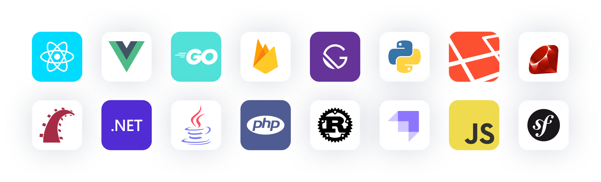

<p align="center">
  <a href="https://www.meilisearch.com/?utm_campaign=oss&utm_source=github&utm_medium=meilisearch&utm_content=logo#gh-light-mode-only" target="_blank">
    
  </a>
  <a href="https://www.meilisearch.com/?utm_campaign=oss&utm_source=github&utm_medium=meilisearch&utm_content=logo#gh-dark-mode-only" target="_blank">
    
  </a>
</p>

<h4 align="center">
  <a href="https://www.meilisearch.com/?utm_campaign=oss&utm_source=github&utm_medium=meilisearch&utm_content=nav">Website</a> |
  <a href="https://www.meilisearch.com/roadmap">Roadmap</a> |
  <a href="https://www.meilisearch.com/cloud?utm_campaign=oss&utm_source=github&utm_medium=meilisearch&utm_content=nav">Meilisearch Cloud</a> |
  <a href="https://blog.meilisearch.com/?utm_campaign=oss&utm_source=github&utm_medium=meilisearch&utm_content=nav">Blog</a> |
  <a href="https://www.meilisearch.com/docs?utm_campaign=oss&utm_source=github&utm_medium=meilisearch&utm_content=nav">Documentation</a> |
  <a href="https://www.meilisearch.com/docs/faq?utm_campaign=oss&utm_source=github&utm_medium=meilisearch&utm_content=nav">FAQ</a> |
  <a href="https://discord.meilisearch.com/?utm_campaign=oss&utm_source=github&utm_medium=meilisearch&utm_content=nav">Discord</a>
</h4>

<p align="center">
  <a href="https://deps.rs/repo/github/meilisearch/meilisearch"></a>
  <a href="https://github.com/meilisearch/meilisearch/blob/main/LICENSE"></a>
  <a href="https://github.com/meilisearch/meilisearch/queue"></a>
</p>

<p align="center">⚡ A lightning-fast search engine that fits effortlessly into your apps, websites, and workflow 🔍</p>

[Meilisearch](https://www.meilisearch.com?utm_campaign=oss&utm_source=github&utm_medium=meilisearch&utm_content=intro) is a search engine for fast, relevant full-text, semantic, and hybrid search. The easiest way to get started and run it in production is [Meilisearch Cloud](https://cloud.meilisearch.com/register?utm_campaign=oss&utm_source=github&utm_medium=meilisearch&utm_content=intro): create a project and run your first search in minutes, with no servers to deploy, upgrade, or maintain. The engine is open source under the MIT license, so you can also self-host it.

<p align="center" name="demo">
  <a href="https://where2watch.meilisearch.com/?utm_campaign=oss&utm_source=github&utm_medium=meilisearch&utm_content=demo-gif#gh-light-mode-only" target="_blank">
    
  </a>
  <a href="https://where2watch.meilisearch.com/?utm_campaign=oss&utm_source=github&utm_medium=meilisearch&utm_content=demo-gif#gh-dark-mode-only" target="_blank">
    
  </a>
</p>

## ☁️ Ways to run Meilisearch

| | What you get | Get started |
| --- | --- | --- |
| **Meilisearch Cloud** (recommended) | Managed Meilisearch: no servers to deploy or upgrade, plus monitoring, search analytics, and team management. Available in [9 regions](https://www.meilisearch.com/docs/capabilities/platform/infrastructure/regions?utm_campaign=oss&utm_source=github&utm_medium=meilisearch&utm_content=ways-to-run) across Europe, the Americas, and Asia-Pacific. 14-day trial. | [Create a project](https://cloud.meilisearch.com/register?utm_campaign=oss&utm_source=github&utm_medium=meilisearch&utm_content=ways-to-run) |
| **Self-hosted, Community Edition** | The open-source engine under the MIT license, on your own infrastructure. | [Quick start](#-quick-start) |
| **Self-hosted, Enterprise Edition** | Adds sharding and other advanced features. Requires a commercial agreement for production use. | [Editions & licensing](#-editions--licensing) |

Both options run the same engine and expose the same API, so you can start on one and move to the other. See [migrating to Meilisearch Cloud](https://www.meilisearch.com/docs/resources/migration/migrating_cloud?utm_campaign=oss&utm_source=github&utm_medium=meilisearch&utm_content=ways-to-run).

## 🚀 Quick start

### 1. Get a Meilisearch instance

**Option A: Meilisearch Cloud (recommended).** No install. [Start a 14-day trial](https://cloud.meilisearch.com/register?utm_campaign=oss&utm_source=github&utm_medium=meilisearch&utm_content=quick-start), then create a project and pick a region. Your project URL and API keys are on the project settings page.

**Option B: Self-host.** Run the open-source engine locally with Docker:

```sh
docker run -it --rm \
  -p 7700:7700 \
  -v $(pwd)/meili_data:/meili_data \
  getmeili/meilisearch:latest
```

Prefer a binary? Run:
```sh
curl -L https://install.meilisearch.com | sh
./meilisearch
```

More options: [install Meilisearch locally](https://www.meilisearch.com/docs/resources/self_hosting/getting_started/install_locally?utm_campaign=oss&utm_source=github&utm_medium=meilisearch&utm_content=quick-start).

### 2. Add documents

```sh
curl -X POST "https://ms-url-example.meilisearch.io/indexes/movies/documents" \
  -H 'Content-Type: application/json' \
  -H "Authorization: Bearer apiKey" \
  --data-binary '[
    { "id": 1, "title": "Carol", "genres": ["Romance", "Drama"] },
    { "id": 2, "title": "Wonder Woman", "genres": ["Action", "Adventure"] },
    { "id": 3, "title": "Life of Pi", "genres": ["Adventure", "Drama"] }
  ]'
```

### 3. Search, typo included

```sh
curl -X POST "https://ms-url-example.meilisearch.io/indexes/movies/search" \
  -H 'Content-Type: application/json' \
  -H "Authorization: Bearer apiKey" \
  --data-binary '{ "q": "wondre woman" }'
```

Meilisearch returns *Wonder Woman* despite the typo. Indexing is asynchronous, so if the search comes back empty, wait a moment and retry.

Next steps: follow a 5-minute quick start for [JavaScript](https://www.meilisearch.com/docs/getting_started/sdks/javascript?utm_campaign=oss&utm_source=github&utm_medium=meilisearch&utm_content=quick-start), [Python](https://www.meilisearch.com/docs/getting_started/sdks/python?utm_campaign=oss&utm_source=github&utm_medium=meilisearch&utm_content=quick-start), [PHP](https://www.meilisearch.com/docs/getting_started/sdks/php?utm_campaign=oss&utm_source=github&utm_medium=meilisearch&utm_content=quick-start), [Ruby](https://www.meilisearch.com/docs/getting_started/sdks/ruby?utm_campaign=oss&utm_source=github&utm_medium=meilisearch&utm_content=quick-start), [Go](https://www.meilisearch.com/docs/getting_started/sdks/go?utm_campaign=oss&utm_source=github&utm_medium=meilisearch&utm_content=quick-start), [Rust](https://www.meilisearch.com/docs/getting_started/sdks/rust?utm_campaign=oss&utm_source=github&utm_medium=meilisearch&utm_content=quick-start), or [React](https://www.meilisearch.com/docs/getting_started/instant_meilisearch/react?utm_campaign=oss&utm_source=github&utm_medium=meilisearch&utm_content=quick-start), or follow the [Cloud getting started guide](https://www.meilisearch.com/docs/getting_started/first_project?utm_campaign=oss&utm_source=github&utm_medium=meilisearch&utm_content=quick-start).

## ✨ Features
- **Hybrid search:** Combine the best of both [semantic](https://www.meilisearch.com/docs/learn/experimental/vector_search?utm_campaign=oss&utm_source=github&utm_medium=meilisearch&utm_content=features) & full-text search to get the most relevant results
- **Search-as-you-type:** Find & display results in less than 50 milliseconds to provide an intuitive experience
- **[Typo tolerance](https://www.meilisearch.com/docs/learn/relevancy/typo_tolerance_settings?utm_campaign=oss&utm_source=github&utm_medium=meilisearch&utm_content=features):** get relevant matches even when queries contain typos and misspellings
- **[Filtering](https://www.meilisearch.com/docs/learn/fine_tuning_results/filtering?utm_campaign=oss&utm_source=github&utm_medium=meilisearch&utm_content=features) and [faceted search](https://www.meilisearch.com/docs/learn/fine_tuning_results/faceted_search?utm_campaign=oss&utm_source=github&utm_medium=meilisearch&utm_content=features):** enhance your users' search experience with custom filters and build a faceted search interface in a few lines of code
- **[Sorting](https://www.meilisearch.com/docs/learn/fine_tuning_results/sorting?utm_campaign=oss&utm_source=github&utm_medium=meilisearch&utm_content=features):** sort results based on price, date, or pretty much anything else your users need
- **[Synonym support](https://www.meilisearch.com/docs/learn/relevancy/synonyms?utm_campaign=oss&utm_source=github&utm_medium=meilisearch&utm_content=features):** configure synonyms to include more relevant content in your search results
- **[Geosearch](https://www.meilisearch.com/docs/learn/fine_tuning_results/geosearch?utm_campaign=oss&utm_source=github&utm_medium=meilisearch&utm_content=features):** filter and sort documents based on geographic data
- **[Extensive language support](https://www.meilisearch.com/docs/learn/what_is_meilisearch/language?utm_campaign=oss&utm_source=github&utm_medium=meilisearch&utm_content=features):** search datasets in any language, with optimized support for Chinese, Japanese, Hebrew, and languages using the Latin alphabet
- **[Security management](https://www.meilisearch.com/docs/learn/security/master_api_keys?utm_campaign=oss&utm_source=github&utm_medium=meilisearch&utm_content=features):** control which users can access what data with API keys that allow fine-grained permissions handling
- **[Multi-Tenancy](https://www.meilisearch.com/docs/learn/security/multitenancy_tenant_tokens?utm_campaign=oss&utm_source=github&utm_medium=meilisearch&utm_content=features):** personalize search results for any number of application tenants
- **Highly Customizable:** customize Meilisearch to your specific needs or use our out-of-the-box and hassle-free presets
- **[RESTful API](https://www.meilisearch.com/docs/reference/api/overview?utm_campaign=oss&utm_source=github&utm_medium=meilisearch&utm_content=features):** integrate Meilisearch in your technical stack with our plugins and SDKs
- **[Conversational search](https://www.meilisearch.com/docs/capabilities/conversational_search/overview?utm_campaign=oss&utm_source=github&utm_medium=meilisearch&utm_content=features):** let users ask questions in natural language and get AI-generated answers grounded in your search results
- **[Personalization](https://www.meilisearch.com/docs/capabilities/personalization/overview?utm_campaign=oss&utm_source=github&utm_medium=meilisearch&utm_content=features):** tailor search results to individual users based on their preferences and behavior
- **[Search rules](https://www.meilisearch.com/docs/capabilities/search_rules/overview?utm_campaign=oss&utm_source=github&utm_medium=meilisearch&utm_content=features):** define custom rules to dynamically adjust search behavior based on context
- **[Document relations](https://www.meilisearch.com/docs/capabilities/indexing/how_to/document_relations?utm_campaign=oss&utm_source=github&utm_medium=meilisearch&utm_content=features):** link documents across indexes to enrich search results with related data
- **[Replication & sharding](https://www.meilisearch.com/docs/resources/self_hosting/sharding/overview?utm_campaign=oss&utm_source=github&utm_medium=meilisearch&utm_content=features):** scale horizontally by distributing your data across multiple nodes
- **AI-ready:** works out of the box with LangChain and MCP (see [AI & LLM integrations](#-ai--llm-integrations))
- **Easy to deploy and maintain:** start in minutes on [Meilisearch Cloud](https://www.meilisearch.com/cloud?utm_campaign=oss&utm_source=github&utm_medium=meilisearch&utm_content=features) with no servers to manage, or self-host a single binary with Docker, cURL, Homebrew, or APT


## 🖥 Examples

- [**Media**](https://where2watch.meilisearch.com/?utm_campaign=oss&utm_source=github&utm_medium=meilisearch&utm_content=demos) — Search movies and streaming platforms to watch them using [hybrid search](https://www.meilisearch.com/solutions/hybrid-search?utm_campaign=oss&utm_source=github&utm_medium=meilisearch&utm_content=demos).
- [**Agentic search**](https://what2watch.meilisearch.com/?utm_campaign=oss&utm_source=github&utm_medium=meilisearch&utm_content=demos) — Chat with an AI agent to recommend movies and streaming platforms.
- [**Flickr**](https://flickr.meilisearch.com/?utm_campaign=oss&utm_source=github&utm_medium=meilisearch&utm_content=demos) — Search and explore one hundred million Flickr images with semantic search.
- [**Ecommerce**](https://ecommerce.meilisearch.com/?utm_campaign=oss&utm_source=github&utm_medium=meilisearch&utm_content=demos) — Ecommerce website using disjunctive [facets](https://www.meilisearch.com/docs/learn/fine_tuning_results/faceted_search?utm_campaign=oss&utm_source=github&utm_medium=meilisearch&utm_content=demos), range and rating filtering, and pagination.
- [**Home Booking**](https://www.meilisearch.com/docs/resources/demos/home_booking?utm_campaign=oss&utm_source=github&utm_medium=meilisearch&utm_content=demos) - A conversational search demo for finding holiday rentals using natural language.
- [**Search Playground**](https://www.meilisearch.com/docs/resources/demos/playground?utm_campaign=oss&utm_source=github&utm_medium=meilisearch&utm_content=demos) — An interactive playground to explore Meilisearch search features.
- [**Personalization**](https://www.meilisearch.com/docs/resources/demos/personalized_search?utm_campaign=oss&utm_source=github&utm_medium=meilisearch&utm_content=demos) — A demo showcasing personalized search results tailored to individual users.
- [**SaaS**](https://saas.meilisearch.com/?utm_campaign=oss&utm_source=github&utm_medium=meilisearch&utm_content=demos) — Search for contacts, deals, and companies in this [multi-tenant](https://www.meilisearch.com/docs/learn/security/multitenancy_tenant_tokens?utm_campaign=oss&utm_source=github&utm_medium=meilisearch&utm_content=demos) CRM application.

See the list of all our [interactive demos](https://www.meilisearch.com/docs/resources/demos/overview?utm_campaign=oss&utm_source=github&utm_medium=meilisearch&utm_content=demos).

## 🧰 SDKs & integration tools

Install one of our SDKs in your project for seamless integration between Meilisearch and your favorite language or framework!

Take a look at the complete [Meilisearch integration list](https://www.meilisearch.com/docs/learn/what_is_meilisearch/sdks?utm_campaign=oss&utm_source=github&utm_medium=meilisearch&utm_content=sdks-link).

[](https://www.meilisearch.com/docs/learn/what_is_meilisearch/sdks?utm_campaign=oss&utm_source=github&utm_medium=meilisearch&utm_content=sdks-logos)

## 🤖 AI & LLM integrations

- **[MCP server](https://www.meilisearch.com/docs/getting_started/integrations/mcp?utm_campaign=oss&utm_source=github&utm_medium=meilisearch&utm_content=ai):** Meilisearch ships a native MCP server at the `/mcp` route (experimental), so AI agents and MCP clients can search your indexes directly. It works the same on Meilisearch Cloud and self-hosted instances.
- **[LangChain](https://www.meilisearch.com/docs/getting_started/integrations/langchain?utm_campaign=oss&utm_source=github&utm_medium=meilisearch&utm_content=ai):** use Meilisearch as a LangChain vector store.
- **[Conversational search](https://www.meilisearch.com/docs/capabilities/conversational_search/overview?utm_campaign=oss&utm_source=github&utm_medium=meilisearch&utm_content=ai):** answer natural-language questions with responses grounded in your indexed data.
- **[llms.txt](https://www.meilisearch.com/docs/llms.txt):** a machine-readable index of the Meilisearch documentation for LLMs and coding agents.

## 📖 Documentation

The full documentation is at [meilisearch.com/docs](https://www.meilisearch.com/docs/?utm_campaign=oss&utm_source=github&utm_medium=meilisearch&utm_content=docs).

Experienced users will want to keep our [API Reference](https://www.meilisearch.com/docs/reference/api/overview?utm_campaign=oss&utm_source=github&utm_medium=meilisearch&utm_content=advanced) close at hand.

We also offer a wide range of dedicated guides to all Meilisearch features, such as [filtering](https://www.meilisearch.com/docs/learn/fine_tuning_results/filtering?utm_campaign=oss&utm_source=github&utm_medium=meilisearch&utm_content=advanced), [sorting](https://www.meilisearch.com/docs/learn/fine_tuning_results/sorting?utm_campaign=oss&utm_source=github&utm_medium=meilisearch&utm_content=advanced), [geosearch](https://www.meilisearch.com/docs/learn/fine_tuning_results/geosearch?utm_campaign=oss&utm_source=github&utm_medium=meilisearch&utm_content=advanced), [API keys](https://www.meilisearch.com/docs/learn/security/master_api_keys?utm_campaign=oss&utm_source=github&utm_medium=meilisearch&utm_content=advanced), and [tenant tokens](https://www.meilisearch.com/docs/learn/security/tenant_tokens?utm_campaign=oss&utm_source=github&utm_medium=meilisearch&utm_content=advanced).

Finally, for more in-depth information, refer to our articles explaining fundamental Meilisearch concepts such as [documents](https://www.meilisearch.com/docs/learn/core_concepts/documents?utm_campaign=oss&utm_source=github&utm_medium=meilisearch&utm_content=advanced) and [indexes](https://www.meilisearch.com/docs/learn/core_concepts/indexes?utm_campaign=oss&utm_source=github&utm_medium=meilisearch&utm_content=advanced).

## ❓ FAQ

<details>
<summary><b>Is there a managed, hosted version of Meilisearch?</b></summary>

Yes. [Meilisearch Cloud](https://www.meilisearch.com/cloud?utm_campaign=oss&utm_source=github&utm_medium=meilisearch&utm_content=faq) is the managed service run by the team that builds Meilisearch. It handles deployment, upgrades, and backups, and adds monitoring, search analytics, and team management. See [Ways to run Meilisearch](#️-ways-to-run-meilisearch).

</details>

<details>
<summary><b>Should I use Meilisearch Cloud or self-host?</b></summary>

Meilisearch Cloud is the recommended way to use Meilisearch and the fastest way to get started: no servers to deploy, upgrade, or back up, plus monitoring and analytics. Self-hosting runs the same engine with the same API and suits teams that need to operate their own infrastructure. You can move a self-hosted instance to Cloud later: see [migrating to Meilisearch Cloud](https://www.meilisearch.com/docs/resources/migration/migrating_cloud?utm_campaign=oss&utm_source=github&utm_medium=meilisearch&utm_content=faq).

</details>

<details>
<summary><b>Can I host Meilisearch in the EU?</b></summary>

Yes. You can self-host anywhere. Meilisearch Cloud offers EU regions in Frankfurt and Paris, and Paris runs on the AWS European Sovereign Cloud. See [Cloud regions](https://www.meilisearch.com/docs/capabilities/platform/infrastructure/regions?utm_campaign=oss&utm_source=github&utm_medium=meilisearch&utm_content=faq).

</details>

<details>
<summary><b>How does Meilisearch compare to Algolia, Elasticsearch, Typesense, or vector databases?</b></summary>

See the side-by-side comparisons in our documentation: [Algolia](https://www.meilisearch.com/docs/resources/comparisons/algolia?utm_campaign=oss&utm_source=github&utm_medium=meilisearch&utm_content=faq), [Elasticsearch](https://www.meilisearch.com/docs/resources/comparisons/elasticsearch?utm_campaign=oss&utm_source=github&utm_medium=meilisearch&utm_content=faq), [Typesense](https://www.meilisearch.com/docs/resources/comparisons/typesense?utm_campaign=oss&utm_source=github&utm_medium=meilisearch&utm_content=faq), [OpenSearch](https://www.meilisearch.com/docs/resources/comparisons/opensearch?utm_campaign=oss&utm_source=github&utm_medium=meilisearch&utm_content=faq), [Pinecone](https://www.meilisearch.com/docs/resources/comparisons/pinecone?utm_campaign=oss&utm_source=github&utm_medium=meilisearch&utm_content=faq), [Qdrant](https://www.meilisearch.com/docs/resources/comparisons/qdrant?utm_campaign=oss&utm_source=github&utm_medium=meilisearch&utm_content=faq), [PostgreSQL](https://www.meilisearch.com/docs/resources/comparisons/postgresql?utm_campaign=oss&utm_source=github&utm_medium=meilisearch&utm_content=faq), and [MongoDB Atlas Search](https://www.meilisearch.com/docs/resources/comparisons/mongodb?utm_campaign=oss&utm_source=github&utm_medium=meilisearch&utm_content=faq). Migration guides are available for [Algolia](https://www.meilisearch.com/docs/resources/migration/algolia_migration?utm_campaign=oss&utm_source=github&utm_medium=meilisearch&utm_content=faq), [Elasticsearch](https://www.meilisearch.com/docs/resources/migration/elasticsearch_migration?utm_campaign=oss&utm_source=github&utm_medium=meilisearch&utm_content=faq), [Qdrant](https://www.meilisearch.com/docs/resources/migration/qdrant_migration?utm_campaign=oss&utm_source=github&utm_medium=meilisearch&utm_content=faq), and [MongoDB Atlas Search](https://www.meilisearch.com/docs/resources/migration/mongodb_migration?utm_campaign=oss&utm_source=github&utm_medium=meilisearch&utm_content=faq).

</details>

<details>
<summary><b>Can I use Meilisearch with AI agents and RAG?</b></summary>

Yes. Meilisearch supports hybrid and semantic search, conversational search, a native MCP server, and LangChain. See [AI & LLM integrations](#-ai--llm-integrations).

</details>

## 🧾 Editions & Licensing

The Meilisearch engine is available in two editions. Both can be self-hosted. [Meilisearch Cloud](#️-ways-to-run-meilisearch) runs the engine for you as a managed service.

### 🧪 Community Edition (CE)

- Fully open source under the [MIT license](./LICENSE)
- Core search engine with fast and relevant full-text, semantic or hybrid search
- Free to use for anyone, including commercial usage

### 🏢 Enterprise Edition (EE)

- Includes advanced features such as:
  - Sharding
  - S3-streaming snapshots
  - Search rule previews
- Governed by a [commercial license](./LICENSE-EE) or the [Business Source License 1.1](https://mariadb.com/bsl11)
- Not allowed in production without a commercial agreement with Meilisearch.
  - You may use, modify, and distribute the Licensed Work for non-production purposes only, such as testing, development, or evaluation.

Want access to Enterprise features? → Contact us at [sales@meilisearch.com](mailto:sales@meilisearch.com).

### 📦 External crates

Meilisearch vendors the following MIT-licensed external crates with code modifications to use the HTTP client located in `crates/http-clients`:

- `external-crates/async-openai` and `external-crates/async-openai-macros` from <https://github.com/64bit/async-openai>
- `external-crates/reqwest-eventsource` from <https://github.com/jpopesculian/reqwest-eventsource>

## 📊 Telemetry

Meilisearch collects **anonymized** user data to help us improve our product. You can [deactivate this](https://www.meilisearch.com/docs/learn/what_is_meilisearch/telemetry?utm_campaign=oss&utm_source=github&utm_medium=meilisearch&utm_content=telemetry#how-to-disable-data-collection) whenever you want.

To request deletion of collected data, please write to us at [privacy@meilisearch.com](mailto:privacy@meilisearch.com). Remember to include your `Instance UID` in the message, as this helps us quickly find and delete your data.

If you want to know more about the kind of data we collect and what we use it for, check the [telemetry section](https://www.meilisearch.com/docs/learn/what_is_meilisearch/telemetry?utm_campaign=oss&utm_source=github&utm_medium=meilisearch&utm_content=telemetry#how-to-disable-data-collection) of our documentation.

## 📫 Get in touch!

Meilisearch is a search engine created by [Meili](https://www.meilisearch.com/careers), a software development company headquartered in France and with team members all over the world. Want to know more about us? [Check out our blog!](https://blog.meilisearch.com/?utm_campaign=oss&utm_source=github&utm_medium=meilisearch&utm_content=contact)

🗞 [Subscribe to our newsletter](https://share-eu1.hsforms.com/1LN5N0x_GQgq7ss7tXmSykwfg3aq) if you don't want to miss any updates! We promise we won't clutter your mailbox: we only send one edition every two months.

💌 Want to make a suggestion or give feedback? Here are some of the channels where you can reach us:

- For feature requests, please visit our [product repository](https://github.com/meilisearch/product/discussions)
- Found a bug? Open an [issue](https://github.com/meilisearch/meilisearch/issues)!
- Want to be part of our Discord community? [Join us!](https://discord.meilisearch.com/?utm_campaign=oss&utm_source=github&utm_medium=meilisearch&utm_content=contact)

Thank you for your support!

## 👩‍💻 Contributing

Meilisearch is, and will always be, open-source! If you want to contribute to the project, please look at [our contribution guidelines](CONTRIBUTING.md).

## 📦 Versioning

Meilisearch releases and their associated binaries are available on the project's [releases page](https://github.com/meilisearch/meilisearch/releases).

The binaries are versioned following [SemVer conventions](https://semver.org/). To know more, read our [versioning policy](./documentation/versioning-policy.md).

Differently from the binaries, crates in this repository are not currently available on [crates.io](https://crates.io/) and do not follow [SemVer conventions](https://semver.org).
